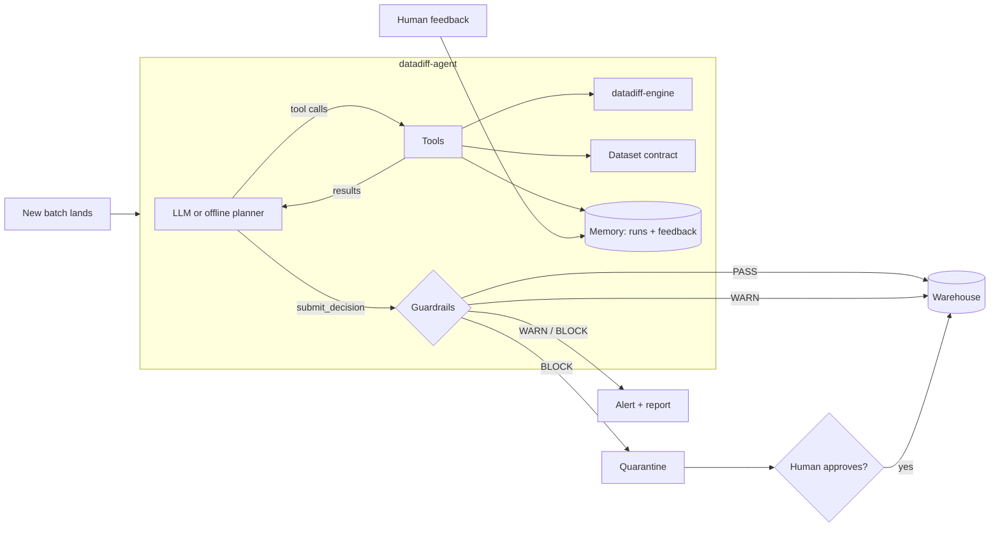

# datadiff-agent

**An AI agent that guards data pipelines.** Every new batch of data is compared with the last good batch using [datadiff-engine](https://pypi.org/project/datadiff-engine/). The agent investigates what changed, weighs it against the dataset's business contract and its memory of past incidents, and decides: **PASS** (load), **WARN** (load and alert), or **BLOCK** (quarantine for a human).

Bad data rarely crashes a pipeline. It loads quietly: a file arrives with fares in the wrong currency, a renamed column, or half the rows missing, and nobody notices until a report is wrong. Fixed rules catch some of this but raise too many false alarms. This agent combines datadiff-engine's checks with context and judgement, and stays inside hard guardrails.

```text
── Day 4: fares switched to USD (bookings_2026-10-04.csv)
    1. get_dataset_contract()
    2. compare_batches()
    3. get_run_history()
    4. get_column_details({"column": "currency"})
    5. get_column_details({"column": "fare_amount"})
    6. submit_decision(decision='BLOCK', severity='CRITICAL', findings=3)
   [alert] ⛔ *BLOCK* bookings/bookings_2026-10-04.csv (CRITICAL)
   Decision: BLOCK · severity CRITICAL
   3 notable issue(s): New value(s) in 'currency' not seen before: 'USD' (100%) of rows.
   This is a critical column.; Numeric drift in 'fare_amount': mean +164.6%, median +172.8%,
   p95 +157.2%. This is a critical column.; Several critical columns changed at the same time
   (currency, fare_amount), which points to a systematic upstream change.
   → quarantined. Report: reports/bookings__bookings_2026-10-04__run3.md
```

*(Output of `datadiff-agent demo -v` in offline mode.)*

## What makes it an agent

| Capability | How it's done here | Where |
|---|---|---|
| **Tool use** | The model calls 6 narrow, read-only tools: contract, compare, column details, sample values, history, decision | [`tools.py`](src/datadiff_agent/tools.py) |
| **Reasoning loop** | Observe → call tools → read results → repeat → submit a structured decision | [`agent.py`](src/datadiff_agent/agent.py) |
| **Context** | A dataset contract says which columns are critical and which reports depend on them | [`contracts.py`](src/datadiff_agent/contracts.py) |
| **Memory** | Past decisions and human feedback in SQLite; issues marked as false positives are treated as expected next time | [`memory.py`](src/datadiff_agent/memory.py) |
| **Guardrails** | Deterministic rules set a floor the model can't go below (e.g. a missing critical column is always BLOCK); fail closed if the agent can't decide | [`policy.py`](src/datadiff_agent/policy.py) |
| **Human in the loop** | Blocked batches are quarantined; a person can approve loading them anyway | [`actions.py`](src/datadiff_agent/actions.py) |
| **Actions** | Load to the warehouse, quarantine, Markdown incident report, Slack alert | [`pipeline.py`](src/datadiff_agent/pipeline.py) |
| **Observability** | Every tool call is traced and saved in the report | [`agent.py`](src/datadiff_agent/agent.py) |
| **MCP server** | Exposes datadiff-engine to Claude Desktop, Claude Code or any MCP client, with path sandboxing | [`mcp_server.py`](src/datadiff_agent/mcp_server.py) |
| **Model-agnostic** | Groq, OpenAI, Ollama (any OpenAI-compatible API), or a fully offline rule-based planner | [`llm.py`](src/datadiff_agent/llm.py) |

## Architecture



## Quick start

Requires Python 3.10+ and datadiff-engine 0.2.0 or later.

```bash
pip install -e ".[dev]"
datadiff-agent demo            # offline, no API key needed
```

The demo runs a week of synthetic airline booking files through the pipeline:

| Day | What happened to the file | Agent |
|---|---|---|
| 1 | Normal (becomes the baseline) | loaded |
| 2 | Normal day-to-day variation | **PASS** |
| 3 | `passenger_email` 35% missing (CRM-only column) | **WARN** |
| 4 | Fares switched from OMR to USD | **BLOCK** |
| 5 | `fare_amount` renamed to `total_fare` | **BLOCK** |
| 6 | Partial file, 70% of rows missing | **BLOCK** |
| 7 | Same email gap as day 3, after a person marked it as a known issue | **PASS** (memory) |

Add `-v` to see every tool call, or `--interactive` to approve or reject blocked batches yourself.

### With a real LLM

The agent works with any OpenAI-compatible API that supports tool calling. Groq has a free tier:

```bash
export GROQ_API_KEY=...                       # https://console.groq.com
datadiff-agent demo --dir demo_llm            # picks Groq automatically when the key is set

# or choose explicitly
datadiff-agent demo --provider groq --model llama-3.3-70b-versatile
datadiff-agent demo --provider ollama --model llama3.1            # local, free
DATADIFF_AGENT_MODEL=<model> datadiff-agent demo --provider openai
```

Comparing the LLM's decisions with the offline planner's on the same week is a good first experiment. An LLM can notice things the rules can't, like *why* fares jumped, by looking at sample values.

### Review a single batch

```bash
datadiff-agent check yesterday.csv today.csv --contract bookings
# exit code: 0 PASS · 1 WARN · 2 BLOCK · 3 error

datadiff-agent history                          # past decisions + feedback
datadiff-agent feedback 12 false_positive --note "known CRM gap"
```

## Use it in a real pipeline

The agent is a quality gate in front of your load step. On Databricks, Airflow or any scheduler:

```python
from datadiff_agent.agent import run_agent
from datadiff_agent.contracts import load_contract
from datadiff_agent.llm import model_from_env
from datadiff_agent.memory import Memory
from datadiff_agent.tools import RunContext

ctx = RunContext(
    dataset="bookings",
    batch=file_name,
    old=last_good_df,          # e.g. spark_df.toPandas() of yesterday's batch
    new=new_df,
    contract=load_contract("contracts/bookings.json"),
    memory=Memory("/dbfs/agents/bookings_memory.db"),
)
result = run_agent(ctx, model_from_env())

if result.decision == "BLOCK":
    raise RuntimeError(f"Batch blocked: {result.summary}")   # fails the job, file stays in landing
```

Or call the CLI from any shell step and use the exit code.

## Use it from Claude (MCP)

```bash
pip install -e ".[mcp]"
datadiff-agent mcp --data-root /path/to/data
```

Claude Desktop (`claude_desktop_config.json`):

```json
{
  "mcpServers": {
    "datadiff": {
      "command": "datadiff-agent",
      "args": ["mcp", "--data-root", "/absolute/path/to/data"]
    }
  }
}
```

Then ask: *"Compare yesterday's and today's bookings file and tell me if it's safe to load."* The server can only read files inside `--data-root`.

## Write a contract for your dataset

Copy [`src/datadiff_agent/contract_specs/bookings.json`](src/datadiff_agent/contract_specs/bookings.json) and edit it. Mark columns that feed business reports as `critical`, mark IDs as `identifier` (skipped for numeric drift), and tune the thresholds. The better the contract, the better the decisions.

## Design decisions

- **The final answer is a tool call.** `submit_decision` has a JSON schema, so the decision is validated before it's trusted, and invalid output is sent back to the model to fix.
- **Rules constrain the model, never the other way round.** The model may be stricter than the guardrails but never more lenient. An agent that can't decide within its step budget blocks the batch: fail closed.
- **Tools are narrow and read-only.** The model never sees file paths, SQL or a shell. The MCP server sandboxes file access to one folder.
- **WARN batches are loaded but don't become the baseline**, so a problem never quietly becomes the new normal.
- **Learning from feedback is explicit.** No retraining: human verdicts are stored and shown to the model as history, and the effect is visible and auditable.

## Development

```bash
pip install -e ".[dev]"
pytest
```

The tests cover the agent loop with scripted and misbehaving models (a model that always says PASS is overruled, a model that never decides fails closed, invalid decisions are corrected), the real-LLM code path with a fake OpenAI client, memory, guardrails, the full demo pipeline, the CLI and the MCP server.

## Roadmap

- [ ] Evaluation harness: score LLM vs. offline decisions across many generated scenarios
- [ ] Statistical drift tools (KS test, PSI) the agent can call for a second opinion
- [ ] Column-level feedback ("only the email part was a false positive")
- [ ] Spark DataFrame support without converting to pandas
- [ ] LangGraph and Google ADK versions of the agent loop

## License

MIT · Built on [datadiff-engine](https://github.com/Rohesen/datadiff-engine).
